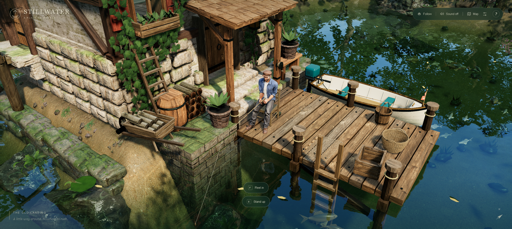

# STILLWATER — offline mirror

Full mirror of **Stillwater — the mill island** (https://stillwater.zavrenn.chatgpt.site/).

Source: https://stillwater.zavrenn.chatgpt.site/



## Stack

- **Vite production build on a `*.chatgpt.site` deployment** — the origin root
  serves `index.html` plus `assets/index-BogB70q-.js` (the whole app as one
  1,372,053 B minified classic-script bundle) and
  `assets/index-D7i12YD8.css` (16,734 B stylesheet). No framework, no runtime
  chunk graph: one flat bundle whose modules the build concatenated.
- **three.js r186 fused into the bundle** — the bundler merged the three.js core
  (constants … WebGLRenderer, `window.__THREE__ = '186'`), the GLTFLoader addon
  with its KHR_* plugins (DRACO/KTX2/meshopt hooks) and the MeshoptDecoder
  module with its embedded wasm directly into the app bundle.
- **The deployment's own asset map** — the built entry carries
  `<meta name="stillwater-assets" content='{"/textures/…":"<rev>", …}'>`
  (153 paths) and the bundle's `uf()` helper appends `?v=<rev>` to every
  same-origin asset it loads through that map. The capture probes all 153
  directly; the revision map is the deployment's, byte-exact in the capture.
- **Static asset tree, fetched at boot** — `/textures/` (material webp, canopy
  atlas webp+json, HDR sky, water normal, a scar decal), `/models/` and
  `/compact/models/` (glTF props, architecture, trees, fisher), `/compact/textures/`
  (keeper + material png/jpg), `/audio/` (three ogg loops + `SOURCES.md`) and
  `/licenses/` (four attribution txt). The game preloads the world at its
  loading screen; one material texture was never requested in the play session.
- **Cloudflare machinery** — the host injects a bot-challenge inline block into
  the entry document (token rotates per response) which loads
  `/cdn-cgi/challenge-platform/scripts/jsd/main.js` (captured once, recorded
  `dynamic: true`). The script's `oneshot` beacon POSTs to a Cloudflare
  challenge endpoint at runtime — machinery, not deployment content, and
  404 locally by design.
- **SPA catch-all** — the host answers ANY unknown path with HTTP 200 and the
  entry document (`text/html`). A capture probe therefore only counts a
  response as the file when it is NOT the HTML fallback; `/index.html`
  itself 307-redirects to `/`.

## What this is

STILLWATER — the mill island (stillwater.zavrenn.chatgpt.site) — "Let the world
wait. An old mill. A wooden boat. And nowhere you need to be." A quiet 3D
exploration game: you are the mill keeper on a small wooded island, free to walk
the landing and bridge, sit and fish from the dock, the chair or the boat, and
paddle the pond (its meta description: "A small world, a wooden boat, and
nowhere you need to be"). The whole game is the one Vite bundle plus its asset
tree — no accounts, no backend, nothing off-origin.

The capture is **157 files, 176,886,452 bytes (168.7 MiB)** — entry document
(24,712 B), the bundle and stylesheet, the 153 meta-declared assets, the og
preview image, and the Cloudflare challenge script. Closure was iterated to
fixpoint with the static scanner (HTML attributes/quoted strings, JS literals,
specifiers, `new URL()`, CSS `url()`/`@import`) plus the deployment's own asset
map and the bundle's template-literal target tables (the `scan-*`, `fern*-views`
and two placement models the literal scanner cannot resolve), then cross-checked
against an opencli browser network log recorded while the game ran on loopback
(`docs/boot-network-2026-10-13.json`, 296 entries / 148 distinct same-origin
paths): **every same-origin request the running game made is a captured file**,
plus one Cloudflare `oneshot` beacon (machinery). The only game-file 404 the
mirror server logged across the session is that beacon.

External at runtime: **none** — the app loads nothing off-origin. Cloudflare's
injected challenge script is captured, but its `oneshot` POST target is a
Cloudflare endpoint that stays external (the mirror is not a Cloudflare zone);
it is documented, not backfilled.

Gaps (16, all recorded in `_mirror-report.json`): the host answers these
referenced paths with the SPA fallback (HTTP 200 + entry document), i.e. they
are not served upstream — `favicon.ico` (browser-implicit; the document's own
icon is a data: URI), `models/pebble.glb`, `models/clearinggrass.glb`,
`textures/fern0-views.{webp,json}`, `textures/fern1-views.{webp,json}` and the
nine `textures/scan-{ground,pebbles,sand}-{albedo,normal,roughness}.webp`
templates the bundle builds but the deployment never ships (the run never
requests them; they belong to an unpublished content variant).

## Layout

- `index.html` — the entry document as served at the origin root, byte-exact
  (including the Cloudflare-injected token block)
- `assets/` — the app bundle and stylesheet as served
- `textures/`, `models/`, `compact/`, `audio/`, `licenses/`,
  `stillwater-preview.jpg` — the asset tree as served
- `cdn-cgi/challenge-platform/scripts/jsd/main.js` — the Cloudflare challenge
  script as served once (rotating; `dynamic: true` in the manifest)
- `.upstream/manifest.json` — sha256 for every captured file (157 files)
- `readable/` — prettified derived layer (pinned prettier 3.9.6) for the app
  bundle (66,160 lines), the stylesheet (1,269), the Cloudflare script (2,027)
  and the two inline entry-document blocks (11 + 33), plus
  `readable/index-inline-map.json` (inline byte ranges + sha256)
- `src/` + `split-spec.json` — the reversed app layer (2026-10-14 structure
  pass): 68 statement-aligned slices of the app bundle's own code — every slice
  a whole run of top-level statements inside ONE reviewed semantic cluster
  (`src/<cluster>-NN.js`: `island-01.js`, `water-surface-01.js`,
  `waterwheel-kinematics-01.js`, `keeper-poses-02.js`, …) plus the inline
  recovery handler — with the derivation spec recording each cluster and its
  reading. 12 vendor module regions inside the bundle (three.js core,
  HDRLoader, the examples postprocessing stack, BufferGeometryUtils,
  SkeletonUtils, GLTFLoader + parser, MeshoptDecoder, OrbitControls, Reflector,
  Sky, RoundedBoxGeometry, the Vite polyfill) are wholeFile sections: indexed
  in `readable/`, content-anchored, never sliced
- `rename-map.json` — the recovered per-file rename layer over `src/`
  (`files` word-boundary map + `scoped` token-index records; 62 files, 519
  names, 2,173 identifier splices)
- `legacy/2026-10-14/` — the superseded derived layer (the previous 77 slices +
  its `split-spec.json`), kept as the rollback copy
- `tools/derive.mjs` — rebuild `readable/` + `src/` + `split-spec.json`
- `tools/apply-names.mjs` — apply the reviewed renames (`tools/names.json`)
- `tools/recover-scoped-map.mjs` — record the achieved map into `rename-map.json`
- `tools/verify-rename.mjs` — per-file rename gate (reproduces/references/bindings)
- `tools/check-chunk.mjs` — whole-bundle gate (re-splice byte-identical,
  cross-slice references resolve)
- `tools/refcheck.mjs`, `tools/engine/rename-layer.mjs` — the shared
  scope/token engine the rename tools use (acorn from `tools/.deps`, gitignored)
- `tools/capture.mjs` — the byte-exact capture + closure crawler (re-runnable;
  `--check` is the static closure audit)
- `tools/update.mjs` — read-only drift probe against the live site
- `tools/verify.mjs` — re-hash the capture against the manifest
- `tools/audit.js` — integrity gate for the derived layers (`AUDIT PASS`)
- `tools/net-crosscheck.mjs` — compare a recorded browser network log against
  the manifest (`node tools/net-crosscheck.mjs docs/boot-network-2026-10-13.json`)
- `tools/serve.mjs` — loopback static server used for the boot test

## Assets

- **world/terrain models** — 27 glb: `models/` (wheel, rocks, stoneblock, bank
  covers, grass, fern0/1, foxglove, flowers, mushrooms, shrub, pebbles,
  waterplant, lily, lilypad, reeds, wheelbarrow, log, fence)
- **architecture/terrain/props models (compact set)** — 27 glb + 3 json under
  `compact/models/` (mill, milldetails, millinterior, milldoor, millsidedoor,
  dockprops, bridge, bridgepath, spring, springwater, pondlife, architecture,
  terrain, boat, trees/lods/crowns, fishing-chair, fishing-boat,
  fishing-resident + `resident-motion.json`, `fishing-*-line.json`)
- **textures** — 54 webp + 2 json + 1 hdr + 1 jpg under `textures/` (material
  webp atlas pages incl. the mill scar decal, alder/birch canopy webp+json
  view atlases, `forest-light.hdr` sky, `water-normal.jpg`)
- **compact textures** — 29 png/jpg under `compact/textures/` (keeper-tripo
  colour/normal/orm + 26 material pages)
- **audio** — 3 ogg + 1 md under `audio/` (`birds.ogg`, `water.ogg`,
  `motor.ogg`, `SOURCES.md`)
- **fonts** — none; the UI uses system font stacks
- **licenses** — 4 txt under `licenses/` (`THREE-MIT`, `MESHOPTIMIZER-MIT`,
  `MAKEHUMAN-CC0`, `KEEPER-ATTRIBUTION` — the keeper character is a
  MakeHuman-CC0-derived asset, attributed in-tree)
- **code** — `index.html`, `assets/index-BogB70q-.js`,
  `assets/index-D7i12YD8.css`
- **machinery** — `cdn-cgi/challenge-platform/scripts/jsd/main.js` (Cloudflare)
- **docs** — `docs/cover.png`, `docs/boot-2026-10-13.png`,
  `docs/boot-network-2026-10-13.json`

## Run

Open `index.html` through any static file server, serving the repo root as the
site root (the deploy is origin-root; no build step):

```
node tools/serve.mjs          # http://127.0.0.1:8096/
# or: npx serve .
```

Click **Step outside**, walk with WASD/arrows (or click/hold a spot to walk
there), `E` interacts (sit, board the boat, stand up), `F` fishes, `V` toggles
Explore/Follow view, `R` recenters, the top bar has view/sound/map/settings.
Open the page fresh so the CDN-injected Cloudflare block is inert (it needs the
real CF zone; offline it simply fails and the game is unaffected).

## Verify

```
node tools/verify.mjs             # re-hash the capture against the manifest
node tools/audit.js               # derived-layer integrity gate (AUDIT PASS)
node tools/verify-rename.mjs --all # rename layer: reproduces/references/bindings
node tools/check-chunk.mjs        # whole-bundle re-splice + cross-slice resolve
node tools/capture.mjs --check    # static closure: 0 unresolved beyond recorded gaps
node tools/net-crosscheck.mjs docs/boot-network-2026-10-13.json
```

Rebuild the derived layers from the frozen capture (byte-identical, proven):

```
node tools/derive.mjs && node tools/apply-names.mjs --all && node tools/recover-scoped-map.mjs
```

## Updating from upstream

```
node tools/update.mjs     # read-only drift probe: what changed upstream
```

The probe never rewrites the capture — a mirror is a point-in-time snapshot.
It re-fetches the entry and all 157 captured files and compares: the entry is
normalized (Cloudflare token rotates per response), the challenge script is
`dynamic: true` (presence-only), and everything else must match byte-for-byte.
A refresh means re-running `node tools/capture.mjs` into a clean tree, then
re-cutting the derived layers with `node tools/derive.mjs` (never carrying the
old derived layer over); replaced files are copied to `legacy/<date>/` first.

### 2026-10-13 derivation

> **Superseded 2026-10-14** by the structure pass + rename campaign below: the
> 77-slice `src/` and its `split-spec.json` are archived at
> `legacy/2026-10-14/`. Kept as the record of the first-cut derivation.

Both derived layers are in place, cut from the recorded capture (capture bytes
untouched — `node tools/verify.mjs` re-hashes all 157 files):

- `readable/` — pinned prettier 3.9.6 (module API, default options, single pass
  with re-format idempotence asserted at derive time — never the CLI, it
  respects `.gitignore` and can silently echo its input) rendered the app bundle
  to `assets__index-BogB70q-.pretty.js` (66,160 lines), the stylesheet to
  `assets__index-D7i12YD8.pretty.css` (1,269), the Cloudflare script to
  `cdn-cgi__challenge-platform__scripts__jsd__main.pretty.js` (2,027) and the
  two inline entry blocks to `index-inline-{1,2}.pretty.js` (11 + 33). Every
  pretty is provably not a byte copy of its capture source and re-renders
  byte-exact under the pinned version (5/5 in the gate).
- `src/` — 77 statement-aligned slices (`src/<tag>-NN.js`, exact 2-line
  provenance header) recorded in `split-spec.json` (85 sections: 77 ranged + 8
  wholeFile): 76 windows over the app bundle's app-code runs plus 1 for the
  inline recovery handler. 77/77 parse standalone
  (`node --input-type=module --check -`) and round-trip byte-exact to their
  readable line ranges; cuts land only on top-level declaration boundaries
  (~250-350 line windows; oversized declarations stay whole — the placements
  table, a single 12,241-line declaration, is one slice).
- Vendor rule — wholeFile sections, never sliced, content-anchored and asserted
  in `tools/derive.mjs` and guarded again in `tools/audit.js`: the Vite
  modulepreload polyfill (build machinery), the three.js r186 core
  (constants … WebGLRenderer), the bundled GLTFLoader addon with its KHR_*
  plugins, and the MeshoptDecoder module with its embedded wasm. Machinery rule
  — the Cloudflare challenge script and the entry's inline Cloudflare injection
  are wholeFile. Stylesheet rule — the capture CSS is wholeFile. The inline
  recovery handler is app code: its header comment is a wholeFile head section
  and its single statement is a slice (no skipped sections in this mirror).
- Non-capture content: the entry's inline `<script>` scan finds exactly two
  content blocks (recovery handler, Cloudflare injection); external references
  are only the bundle/stylesheets `<script src>`/`<link>` and the Cloudflare
  script string — no inline `<style>`, no typed data blocks, so `notRendered`
  is empty.
- Gates: `node tools/verify.mjs` → `157 files checked, 0 problems`;
  `node tools/audit.js` → `AUDIT PASS` (77/77 round-trips, 5/5 pretties
  re-render byte-exact, 5/5 pretty sources tiled contiguously, 77/77 slices +
  4/4 pretties parse standalone, 5/5 pretties provably distinct from capture,
  2 inline blocks with twins + index-inline-map.json, capture manifest free of
  derived layers); `node tools/update.mjs` → `up to date: 157 captured files
  identical upstream`; `node tools/capture.mjs --check` → static closure clean
  (0 new unresolved vs the 16 recorded gaps); serve probe — mirror root served
  on loopback (`tools/serve.mjs`, port 8096), game booted and played, listener
  killed, port closed (`netstat`: no LISTENING socket; connection refused).
  Rebuild with `node tools/derive.mjs`.
- Boot evidence: `docs/boot-2026-10-13.png` (right after boot on the loopback
  mirror — the rendered mill landing, welcome overlay and load status) and the
  cover `docs/cover.png` (actual gameplay: the mill keeper fishing from the
  dock, line cast, "Reel in" prompt up). Play actually exercised: Step outside
  → Follow view walking via click-to-walk → fishing (sit, cast the line) →
  stand up → Explore/Follow view toggle. Note for re-shoots: this game switches
  on `KeyboardEvent.code`, which the opencli `keys` command sends empty, so the
  session was driven through the game's own on-screen controls (trusted CDP
  clicks: canvas click-to-walk, the interaction prompt buttons, the view
  toggle) — real input, just pointer-shaped.
- §0.4 fork-over-mirror checked 2026-10-13: **no public upstream source repo
  exists.** The entry HTML, the bundle and the stylesheet carry no repository
  link, no source-map URL and no license header beyond the in-tree
  `licenses/*.txt`; the host exposes no deploy metadata beyond Cloudflare
  headers; GitHub repo searches for the game name and the slug return nothing.
  The GitHub user `zavrenn` (the subdomain's owner, 7 public repos) publishes
  no Stillwater repository — so there is nothing to fork, and the mirror
  stands.

### 2026-10-14 structure pass + identifier rename campaign (the open task, closed)

**Source maps re-checked first (PLAN §5 accelerator): none.** The app bundle
carries no `sourceMappingURL` (external `.map` or inline `data:` URI — both
verified absent), so the real tree cannot be recovered from maps; the work below
is from the bundle itself.

**Structure — the module boundaries the bundle exposes are the VENDOR ones.**
The bundle is one flat classic script (terser output: `join_vars` merges
consecutive top-level declarations, no module-factory tables, no comments), so
the app's own module boundaries are NOT recoverable — a re-cut can only claim
what is provable. What is provable are the twelve three.js/Vite modules the
bundler inlined whole, each a run of consecutive top-level statements carrying
the library's own strings, now claimed as content-anchored wholeFile regions
(asserted first/last statement + region guard at derive time):

| region | statements | identity |
|---|---|---|
| `vite-modulepreload-polyfill.js` | 1 | Vite modulepreload polyfill |
| `three-core.js` | 2–308 | three.js r186 core (constants .. WebGLRenderer) |
| `three-examples-hdrloader.js` | 1 | examples/jsm/loaders/HDRLoader |
| `three-examples-postprocessing.js` | 11 | Pass/FullScreenQuad/RenderPass, GTAO shaders + PoissonDenoiseShader + SimplexNoise + GTAOPass, CopyShader, LuminosityHighPassShader, UnrealBloomPass, OutputShader, OutputPass, ShaderPass |
| `three-examples-buffergeometryutils.js` | 3 | BufferGeometryUtils (mergeGeometries/mergeAttributes/toTrianglesDrawMode) |
| `three-examples-skeletonutils.js` | 2 | SkeletonUtils clone + parallelTraverse |
| `three-examples-gltfloader.js` | 16 | GLTFLoader + KHR_* plugins + the GLTFParser (previously only the loader half was claimed — the parser was misfiled as app code) |
| `three-examples-meshoptdecoder.js` | 1 | MeshoptDecoder with embedded wasm |
| `three-examples-orbitcontrols.js` | 13 | OrbitControls (pointer handlers extracted to bound functions) |
| `three-examples-reflector.js` | 2 | Reflector + ReflectorShader |
| `three-examples-sky.js` | 2 | Sky + SkyShader |
| `three-examples-roundedboxgeometry.js` | 1 | RoundedBoxGeometry |

The app code between them is cut ONLY at top-level declaration boundaries and
ONLY inside one reviewed semantic cluster (a hand-read map over the 385 app
statements, asserted per cluster at derive time, recorded per section in
`split-spec.json` as `cluster` + `content`): 68 slices across 58 clusters —
`boot-utils`, `light-shafts`, `weather`, `island`, `landmarks`, `world-utils`,
`lights`, `render-pipeline`, `terrain`, `material-tuning`, `canopy`,
`placement`, `world-data` (the 12,241-line placements declaration stays whole),
`paths`, `scatter`, `terrain-dressing`, `waterwheel-kinematics`, `sluice-state`,
`sluice-gate`, `mill-interior`, `waterwheel-build`, `ground-cover`, `trees`,
`forest`, `grass-meadow`, `shrubs`, `view-mode`, `collision`,
`world-assembly`, `boat-hull`, `water-surface`, `waterwheel-motion`,
`pond-water`, `pond-life`, `fish`, `birds`, `shores`, `mill-state`, `audio`,
`mill-approach`, `boat-control`, `boat-motion`, `sky-build`, `keeper-turn`,
`keeper-model`, `keeper-poses`, `keeper-walk`, `fishing`, `stove`,
`keeper-room`, `boot-ui`, `renderer`, `map-2d`, `experience`, `input`,
`inspector`, `boot` (+ `recovery-handler` for the inline slice). Windows are
≤600 lines. **Honest limits:** cluster boundaries are an inference from the
code's own content (scene-object names like `Waterwheel-driven mill
machinery`, the `The old landing` lore table, shader uniforms, seed constants —
the reading is recorded per section), not a recovered file list; no source
maps and no module markers exist to do better.

**Rename campaign (PLAN §5) — applied and gated.** `tools/names.json` is the
reviewed artifact: 166 `global` renames (program-scope names cross-referenced
by sibling slices — `Y`→`islandHeight`, `Qf`→`shoreOutline`, `xh`→`worldData`,
`Eh`→`shorePath`, `cp`→`createRandom`, `X`→`millLayout`, `Qg`→
`buildMillMachinery`, `aS`→`buildMillKeeper`, `PS`→`buildFishingLine`,
`Q`→`playerState`, `Z`→`byId`, `mE`→`bootGame`, …) plus scoped per-slice rules
in 8 slices (`island-01`, `boat-hull-01`, `waterwheel-kinematics-01`,
`terrain-01`, `lights-01`, `light-shafts-01`, `boot-utils-01`,
`material-tuning-01`) that name parameters/locals by role (`x`/`z`/`bearing`/
`radius`, `hullContactDistance` locals, `wheelSpillElement` kinematics,
`setupLighting`'s rig, …). Applied at identifier-token spans by
`tools/apply-names.mjs`; the achieved map — `rename-map.json`'s `files`
word-boundary + `scoped` token-index records — is recovered by
`tools/recover-scoped-map.mjs`. Result: **62 of 68 slices carry the layer,
519 names, 2,173 identifier splices (1,567 word-boundary + 606 token-index)**.

Safety rules the tools enforce (and the review relied on): a global rename is
refused when the name is declared or referenced inside a wholeFile region
(vendor/machinery is never renamed — this is why `q` (water level), `Jm`, `Ym`
and the light-field constants `Pp…zp` stay minified: the minifier's `join_vars`
merged their declarations into vendor statements and `${q}` appears inside the
merged shore shader), and every target must be a fresh spelling (no shadowing).
The gates caught two real engine defects during the campaign, fixed in
`tools/engine/rename-layer.mjs` and proven by re-running everything: (1)
identifiers before a ternary `:` were misread as object keys and skipped,
splitting a binding; (2) a bare `let a, b` declarator inside braces looked like
an object shorthand. Vendor identifiers stay minified by construction (vendor
regions are index-only and carry no records). The campaign is **closed**; a
future refresh re-runs it (`derive → apply-names --all → recover-scoped-map`)
and the gates below must stay green.

Gate tails (verbatim, 2026-10-14):

```
node tools/verify.mjs
157 files checked, 0 problems

node tools/audit.js
AUDIT PASS — 84 spec sections (68/68 src↔pretty round-trips byte-exact, 5/5 pretty sources tiled contiguously, 0/0 skipped export-table sections re-verified textually, 68/68 src slices + 4/4 readable/*.pretty.js parse standalone (node --input-type=module --check -), 5/5 pretties provably distinct from their capture source, 16 index-only wholeFile/skipped sections carry no src file, 2 inline content block(s) with twins + index-inline-map.json, 0/0 imports resolve inside the capture (0 whitelisted machinery, 0 accepted as recorded 404 gaps), rename layer: 62 renamed file(s) reproduce from their records (68/68 slice(s) exact), 5/5 pretties re-render byte-exact under pinned prettier 3.9.6 (format-to-fixed-point), capture manifest free of derived layers)

node tools/verify-rename.mjs --all
verify-rename: 62/62 file(s) reproduces YES + references ok YES + bindings ok YES

node tools/check-chunk.mjs
readable/assets__index-BogB70q-.pretty.js: 79 section(s), 59 renamed slice(s)
  re-splice from reversed src/ byte-identical: YES
  cross-slice references resolve: YES
readable/index-inline-1.pretty.js: 2 section(s), 0 renamed slice(s)
  re-splice from reversed src/ byte-identical: YES
  cross-slice references resolve: YES
check-chunk: 5/5 source file(s) re-splice byte-identical, cross-slice references resolve YES

node tools/update.mjs
up to date: 157 captured files identical upstream

node tools/capture.mjs --check
closure check: 11 reference group(s), 0 unresolved (0 new vs _mirror-report.json), 0 external off-origin reference(s)
```

Derive re-run reproducibility: snapshotting all 76 derived files (readable/ +
src/ + split-spec.json + rename-map.json) before and after
`derive.mjs && apply-names.mjs --all && recover-scoped-map.mjs` gives
**all 76 derived bytes identical** (the derive's own self-check also reports
`68/68 parse standalone, 68/68 round-trip byte-exact, self-check clean`).
Serve probe on the mirror root (loopback `tools/serve.mjs`, port 8096): 7/7
targets HTTP 200 (index, bundle, stylesheet, sky HDR, a glb, an ogg), listener
killed, port closed (`netstat`: no LISTENING socket; connection refused).
Record tools stay manifest-driven (capture.mjs / net-crosscheck.mjs /
verify.mjs never walk the tree), so `src/`, `legacy/`, `split-spec.json` and
`_mirror-report.json` cannot enter the capture record — audit re-checks that.
Replaced derived layers are archived: the previous 77-slice `src/` + its
`split-spec.json` live at `legacy/2026-10-14/`.

### Annotated open items

- `q` (water level 0.18), `Jm`/`Ym` (shore uniforms + shore shader), `Pp…zp`
  (light-field shader constants): cannot be renamed without editing a wholeFile
  vendor statement (see the safety rule above) — recorded, not forgotten.
- The app's own module boundaries stay unrecovered (no source maps, no module
  tables — verified 2026-10-14); cluster names are the recorded reading.

## Mirror conventions

- **Capture layer** — the captured files are byte-exact copies of what the
  origin served; nothing in them is edited. The Cloudflare-injected token in
  `index.html` and the `?v=` revision stamps are part of that record.
- **Readable layer** — `readable/` is derived (prettified) and never shipped to
  a browser; it exists so the bundle can actually be read.
- **Provenance** — `.upstream/manifest.json` records sha256 for each captured
  artifact, and `tools/verify.mjs` re-checks it.
- **Drift** — `tools/update.mjs` is read-only: it reports what changed upstream
  and never rewrites the capture.

## Fleet status

<!-- mirror-status:start — feeds _standard/REPO-INDEX.md. Update ONLY your own mirror's block; never edit the shared index (PLAN §8). Rebuild: node _standard/build-index.mjs -->
<!-- cols: cls=classification · ver=verify 0 problems · upd=drift probe · man=manifest · rdbl=readable re-derived · src=reversed src · boot=boot test · top=offline-mirror topic · tag=backup tag · staged=staged not committed -->
| # | repo | cls | ver | upd | man | rdbl | src | boot | top | tag | staged |
|---|---|---|---|---|---|---|---|---|---|---|---|
| 314 | stillwater | mirror | ✓ | ✓ | ✓ | ✓ | ✓ | ✓ | ✓ | — | — |
<!-- mirror-status:end -->
